# enginerules

Motor de regras do RuleEngineLabs em Java 25 + Spring Boot 4, organizado em **Clean Architecture + DDD + Ports & Adapters (hexagonal)**. Executa políticas (grafos de states) compiladas previamente, sem reflection no caminho quente, com o mesmo contrato do engine em Go.

## Visão geral

```mermaid
flowchart LR
  subgraph apps[Apps - Spring Boot, só wiring]
    E[app-engine<br/>/policies/&#123;name&#125;/executions<br/>/previews]
    A[app-admin<br/>/policies, /audits]
  end
  subgraph adapters[Adapters]
    W[adapter-web<br/>Spring MVC]
    X[adapter-expression-builtin]
    P[adapter-persistence-filesystem]
    AWS[adapter-persistence-aws<br/>DynamoDB + S3]
    H[adapter-http-connector]
    G[adapter-grpc-connector]
    C[adapter-cache-memory]
    J[adapter-json-codec]
  end
  subgraph core[Núcleo - Java puro]
    APP[engine-application<br/>use cases + portas]
    D[engine-domain<br/>definition · execution · catalog]
  end
  E --> W & X & P & AWS & H & G & C
  A --> W & X & P & AWS & G
  W --> APP
  P --> APP
  AWS --> APP
  C --> APP
  X --> D
  H --> D
  P --> J
  H --> J
  APP --> D
```



A seta é sempre para dentro: o domínio não conhece nada além do JDK; a aplicação conhece só o domínio; Spring aparece apenas em `adapter-web` e nos `apps`. As regras estão travadas por build (um módulo Gradle por camada/adaptador) e por testes ArchUnit em `architecture-tests`.

## Módulos

| Módulo | Camada | Conteúdo |
|---|---|---|
| `engine-domain` | Domínio | Quatro subdomínios: `definition` (shared kernel: contrato JSON da política, forma canônica), `execution` (compilador, modelo compilado, máquina de estados, SPI de expressão e de I/O), `catalog` (aggregate `Policy`, `PolicyVersion`, SemVer, `ChangeClassifier`, eventos), `rollout` (aggregates `Canary` e `Shadow`, `CanaryEvaluator`, `ShadowComparator`, I/O virtual replay + stub) |
| `engine-application` | Aplicação | Um use case por operação (`CreatePolicy`, `PublishVersion`, `MoveStableVersion`, `RemoveVersion`, `ExecutePolicy`, `PreviewPolicy`, queries) e portas de saída fatiadas por necessidade |
| `adapter-expression-builtin` | Adaptador | Linguagem de expressão compilada para árvore de nós (lexer + parser Pratt), sem reflection |
| `adapter-http-connector` | Adaptador | `apiCall` REST via `java.net.http.HttpClient`; connections resolvidas por configuração |
| `adapter-grpc-connector` | Adaptador | `apiCall` gRPC unário via `DynamicMessage` + `FileDescriptorSet` (sem código gerado); valida o contrato no compile |
| `adapter-persistence-documents` | Suporte | Mapeamento snapshot ↔ documento (política, versão, canary, sombra, auditoria) compartilhado pelos stores |
| `adapter-persistence-filesystem` | Adaptador | Store local em JSON (políticas, versões imutáveis, auditoria append-only), com lock e escrita atômica |
| `adapter-persistence-aws` | Adaptador | DynamoDB (single-table de políticas, `PolicyIndex`, auditoria, canary e sombra com GSI esparso) + snapshot da STABLE em S3 com leitura de contingência |
| `adapter-cache-memory` | Adaptador | L1 de artefatos compilados (singleflight), cache de resultado de `apiCall`, catálogo com refresh por TTL e proteção por geração (G1) |
| `adapter-web` | Adaptador | Controllers finos e tradução de erros para HTTP |
| `adapter-json-codec` | Suporte | Codec JSON mínimo, sem dependências |
| `app-engine` | Main | Plano de dados: execução e preview |
| `app-admin` | Main | Plano de controle: catálogo, versões, STABLE e auditoria |
| `architecture-tests` | Testes | Regras ArchUnit da arquitetura |
| `integration-tests` | Testes | Sobe admin + engine reais (Spring Boot, portas aleatórias) com provider REST e servidor gRPC falsos; 11 features, 75 cenários |

## Como rodar

Pré-requisito: JDK 25 instalado (o Gradle usa o `JAVA_HOME` ou uma instalação local detectada; não há download automático de JDK).

```bash
./gradlew build
./gradlew :app-admin:bootRun    # porta 8081
./gradlew :app-engine:bootRun   # porta 8080
```

Os dois processos compartilham o diretório `ENGINERULES_STORE_DIRECTORY` (padrão `./.data`).

### Store em AWS (DynamoDB + S3) e LocalStack

`ENGINERULES_STORE_TYPE=aws` troca o store de arquivo pelo DynamoDB + S3, sem mudar nada no núcleo. O mesmo código aponta para a conta real ou para o LocalStack, só muda o endpoint:

```bash
docker compose up -d localstack
export ENGINERULES_STORE_TYPE=aws ENGINERULES_AWS_ENDPOINT=http://localhost:4566 AWS_ACCESS_KEY_ID=test AWS_SECRET_ACCESS_KEY=test
ENGINERULES_AWS_CREATE_RESOURCES=true ./gradlew :app-admin:bootRun   # o admin cria tabelas e bucket se faltarem
./gradlew :app-engine:bootRun
```

| Variável | Padrão | Uso |
|---|---|---|
| `ENGINERULES_STORE_TYPE` | `filesystem` | `filesystem` ou `aws` |
| `AWS_REGION` | `sa-east-1` | região das tabelas e do bucket |
| `ENGINERULES_AWS_ENDPOINT` | vazio | endpoint do LocalStack; vazio usa a AWS real |
| `ENGINERULES_AWS_TABLE_PREFIX` | `enginerules-` | prefixo das cinco tabelas (`policies`, `policy-index`, `audit`, `canaries`, `shadows`) |
| `ENGINERULES_AWS_SNAPSHOT_BUCKET` | `enginerules-stable-snapshots` | bucket do snapshot `stable/<nome>.json` |
| `ENGINERULES_AWS_CREATE_RESOURCES` | `false` | só no admin; em ambiente real quem cria é o Terraform |

Credenciais vêm da cadeia padrão do SDK (variáveis, perfil, task role). As métricas do canary/sombra continuam em `ENGINERULES_STORE_DIRECTORY` até o adaptador Prometheus. Detalhes em `docs/adr/0008-dynamodb-e-s3.md`.

```bash
curl -X POST localhost:8081/policies \
  -H 'Content-Type: application/json' -H 'X-Actor-Id: lucas' -H 'X-Actor-Groups: credit-team' \
  -d @examples/age-gate.json

curl -X POST localhost:8080/policies/AgeGate/executions \
  -H 'Content-Type: application/json' -d '{"age": 30, "name": "Ana", "cep": "01001000"}'

curl -X POST localhost:8080/previews -H 'Content-Type: application/json' \
  -d "{\"policy\": $(jq .definition examples/age-gate.json), \"input\": {\"age\": 15}}"
```

## API

| Plano | Rota | Use case |
|---|---|---|
| engine | `POST /policies/{name}/executions` (`?version=`, `X-Policy-Version`, `?noCache=true` ou `Cache-Control: no-cache`, `X-Consumer-Id`) | `ExecutePolicyUseCase` |
| engine | `POST /previews` (`{policy, input}`) | `PreviewPolicyUseCase` |
| admin | `GET /policies` (`namePrefix`, `owner`, `pendingCandidate`, `pageNumber`, `pageSize` ≤ 100) | `PolicyQueries` |
| admin | `POST /policies` (`{name, ownerGroup, allowedConsumers, definition}`) | `CreatePolicyUseCase` |
| admin | `GET /policies/{name}` | `PolicyQueries` |
| admin | `POST /policies/{name}/versions` (`{basedOn, definition}`) | `PublishVersionUseCase` |
| admin | `GET /policies/{name}/versions/{version}` | `PolicyQueries` |
| admin | `PUT /policies/{name}/stable-version` (`{version}`) | `MoveStableVersionUseCase` |
| admin | `DELETE /policies/{name}/versions/{version}` | `RemoveVersionUseCase` |
| admin | `GET /audits` (`policy`, `actor`, `action`) | `AuditQueries` |
| admin | `POST /policies/{name}/canaries` (`{candidate, weight, durationMinutes, criteria, shadowRef}`) | `CanaryUseCases.start` |
| admin | `GET /policies/{name}/canaries` | `RolloutQueries` |
| admin | `PATCH /policies/{name}/canaries/current` (`{extendMinutes}` ou `{status: ENDED/CANCELLED, reason}`) | `CanaryUseCases.extend/end/cancel` |
| admin | `DELETE /policies/{name}/canaries/current` | `CanaryUseCases.cancel` |
| admin | `POST /canary-evaluations` (também roda agendado, `enginerules.canary.evaluation-interval`) | `EvaluateCanariesUseCase` |
| admin | `POST /policies/{name}/shadows` (`{target, percentage, durationMinutes, virtualRoutes, ignoredPaths}`) | `ShadowUseCases.start` |
| admin | `GET /policies/{name}/shadows`, `GET /policies/{name}/shadows/{id}/report` | `RolloutQueries` |
| admin | `PATCH /policies/{name}/shadows/{id}` (`{status: PAUSED/ACTIVE/ENDED}`) | `ShadowUseCases.pause/resume/end` |

Envelopes: resposta autoral `{state, data}` com o status literal do state; erro do executor `{error, message}` sem `state` (500); a versão executada vai no header `X-Policy-Version` e a rota (`stable`, `canary` ou `pinned`) em `X-Policy-Route`, nunca em `data`.

## Canary e modo sombra

- **Canary:** só a candidata pendente entra, MAJOR é recusada (`canary_major_blocked`) até existir contrato explícito. Roteamento por hash do `X-Consumer-Id` (sorteio individual sem ele); versão explícita ignora o canary. `PUT stable-version` é recusado com canary aberto e `DELETE` da versão em uso também. O avaliador (agendado no admin) compara candidata × STABLE na mesma janela: interrupção antecipada (erro ≥ 5% com 100+ amostras), depois do prazo promove (`update` atômico via "em conclusão"), aborta por critério ou fica inconclusivo esperando `extend` (orçamento de +24h; esgotado, aborta). Critérios: global (config do admin) ou por canary, o mais específico substitui o inteiro.
- **Sombra:** cópia assíncrona numa fila limitada (cheia = `DROPPED`), só de requisições respondidas por `stable`/`canary` e sem `noCache`. A execução real grava o I/O em memória; a sombra roda com `replay` e depois `virtualRoutes` (stub), sem cache de resultado e sem chamar nada externo; faltando resposta, `NOT_COMPARABLE`. O comparador trata ausente = `null`, ignora caminhos globais + da política (`data.items[*].campo`) e classifica em `EQUAL`, `DIVERGENT_OUTCOME`, `DIVERGENT_DATA`, `SHADOW_ERROR_ONLY` (incompatibilidade de entrada), `REAL_ERROR_ONLY`, `NOT_COMPARABLE`, `DROPPED`.
- **Métricas:** o engine bufferiza amostras e grava a cada `enginerules.metrics.flush-interval` em `.data/metrics`; o admin lê para avaliar canary e montar o relatório da sombra. Porta `QueryMetricsPort` pronta para um adaptador Prometheus/AMP.

## gRPC

Cada connection gRPC aponta para um `FileDescriptorSet` gerado com `protoc --include_imports --descriptor_set_out=scoring.pb scoring.proto`. O engine precisa de `target`, `plaintext`, `descriptor-set` e `metadata`; o admin só do `descriptor-set` (para validar o contrato ao publicar):

```yaml
enginerules:
  grpc-connections:
    bureau:
      target: bureau.internal:9090
      plaintext: false
      descriptor-set: /etc/enginerules/scoring.pb
      metadata:
        x-tenant: acme
```

## Testes

### Pré-requisitos

| Para rodar | Precisa de |
|---|---|
| Build, unitários, ArchUnit e cobertura | JDK 25 |
| Integrados com store em arquivo | JDK 25 (sobem admin, engine, um provider REST e um servidor gRPC falsos, tudo em portas aleatórias) |
| Integrados em DynamoDB + S3 | JDK 25 + Docker (LocalStack na porta 4566) |

No Windows, troque `./gradlew` por `gradlew.bat` (PowerShell/CMD) ou use o Git Bash com os comandos como estão.

### 1. Build e testes unitários (o que a `feature/**` roda no CI)

```bash
./gradlew build
```

Compila tudo com `-Xlint:all -Werror` (qualquer aviso quebra o build), roda os unitários e o ArchUnit e aplica o gate JaCoCo de **linha ≥ 98% por módulo** (domínio, aplicação e todos os adaptadores). Os integrados não rodam aqui.

Relatórios, por módulo:

| O quê | Onde |
|---|---|
| Testes | `<módulo>/build/reports/tests/test/index.html` |
| Cobertura | `<módulo>/build/reports/jacoco/test/html/index.html` |

Atalhos úteis:

```bash
./gradlew :engine-domain:test                                        # um módulo
./gradlew :engine-domain:test --tests '*PolicyCompilerTest'          # uma classe
./gradlew :adapter-persistence-aws:jacocoTestCoverageVerification   # testes + gate de um módulo
./gradlew :architecture-tests:test                                   # só as regras de arquitetura
```

### 2. Integrados com store em arquivo

```bash
./gradlew :integration-tests:integrationTest
```

Sobe `AdminApplication` e `EngineApplication` reais no mesmo JVM, com um diretório temporário compartilhado, e exercita cada feature por HTTP. `AwsStorageIT` aparece como *skipped* nesse modo. Relatório em `integration-tests/build/reports/tests/integrationTest/index.html`.

Uma feature só: `./gradlew :integration-tests:integrationTest --tests '*CanariesIT'`.

### 3. Integrados em DynamoDB + S3 com LocalStack (o que `develop` e `release/**` rodam no CI)

```bash
docker compose up -d localstack
curl -s http://localhost:4566/_localstack/health      # dynamodb e s3 devem estar "available" ou "running"

ENGINERULES_IT_AWS_ENDPOINT=http://localhost:4566 \
AWS_ACCESS_KEY_ID=test AWS_SECRET_ACCESS_KEY=test AWS_REGION=sa-east-1 \
./gradlew :integration-tests:integrationTest

docker compose down
```

PowerShell:

```powershell
docker compose up -d localstack
$env:ENGINERULES_IT_AWS_ENDPOINT = "http://localhost:4566"
$env:AWS_ACCESS_KEY_ID = "test"; $env:AWS_SECRET_ACCESS_KEY = "test"; $env:AWS_REGION = "sa-east-1"
.\gradlew.bat :integration-tests:integrationTest
```

Com `ENGINERULES_IT_AWS_ENDPOINT` definido, **todo** o conjunto roda com o store em DynamoDB + S3. O admin cria tabelas e bucket com prefixo e nome únicos por execução (`it-<id>-…`, `enginerules-it-<id>`), então execuções seguidas não se misturam e não é preciso limpar o LocalStack entre elas. `AwsStorageIT` só roda nesse modo e confere os itens no DynamoDB, o índice esparso e o snapshot no S3.

### O que cada feature cobre

| Feature | Classe | Cenários |
|---|---|---|
| Criação de política | `PoliciesIT` | 8 |
| Publicação de versão | `VersionPublishingIT` | 8 |
| STABLE (promoção e rollback) | `StableVersionIT` | 5 |
| Remoção de versão | `VersionRemovalIT` | 6 |
| Consultas do catálogo | `PolicyQueriesIT` | 5 |
| Auditoria | `AuditsIT` | 6 |
| Execução (REST, retry, timeout, cache, escrita) | `ExecutionsIT` | 10 |
| Preview | `PreviewsIT` | 6 |
| Canary | `CanariesIT` | 7 |
| Sombra | `ShadowsIT` | 7 |
| gRPC | `GrpcIT` | 7 |
| Store AWS (só LocalStack) | `AwsStorageIT` | 6 |

Estratégia e decisões em `docs/adr/0007-estrategia-de-testes.md`.

### Problemas comuns

| Sintoma | Causa provável |
|---|---|
| `error: warnings found and -Werror specified` | um aviso novo do compilador; corrija o código em vez de remover o `-Werror` |
| `Rule violated for bundle <módulo>: lines covered ratio is 0.97…` | o módulo caiu abaixo de 98%; o relatório JaCoCo do módulo mostra as linhas sem teste |
| `Cannot find a Java installation … languageVersion=25` | falta o JDK 25 ou o `JAVA_HOME` aponta para outra versão |
| Integrados em AWS falham com `Connection refused` | LocalStack não subiu ou a porta 4566 está ocupada (`docker compose ps`) |
| LocalStack não inicia pedindo token | defina `LOCALSTACK_AUTH_TOKEN` (o compose e o CI já repassam a variável) |
| `./gradlew: Permission denied` | `git update-index --chmod=+x gradlew` e commit |

## CI/CD

Mesma esteira do `RuleEngineLabs/engine` (Go), com as convenções de `docs/ci-cd-conventions.md` (cópia idêntica):

| Workflow | Gatilho | Passos |
|---|---|---|
| `feature.yml` | push em `feature/**` e `fix/**` | commitlint · `./gradlew build` (build limpo + unitários + gate 98%) · PR idempotente para `develop` |
| `develop.yml` | push em `develop` | `./gradlew build` · **depois** integrados contra LocalStack (DynamoDB + S3) |
| `release-cut.yml` | manual | calcula a versão pelos Conventional Commits desde a última tag, grava em `gradle.properties`, cria `release/vX.Y.Z` e abre PR para `main` |
| `release.yml` | push em `release/**` | `./gradlew build` · integrados contra LocalStack · build da imagem Docker |
| `release-merge-back.yml` | PR de `release/*` mergeado em `main` | cria a tag e abre PR de volta para `develop` |

Segredos esperados: `AGENT_CLIENT_ID` e `AGENT_APP_PRIVATE_KEY` (GitHub App do agente, como no Go) e, opcional, `LOCALSTACK_AUTH_TOKEN`.

## Contrato da política

Mesmo schema do engine Go (`id`, `kind`, `transitions` `{when, to}` avaliadas em ordem, `fallback` obrigatório em state não terminal, `contextKey` gravando na raiz do contexto, `input` reservado). Kinds suportados nesta fase: `execution`, `apiCall` (REST e gRPC), `parallel`, `response`. `dbQuery` é rejeitado pelo compilador, como previsto para a fase 3.

- `execution.map`: cada valor é uma expressão; o objeto resultante vai para `contextKey`.
- `response.data` e `apiCall.body`: árvore livre; **todo valor string é uma expressão** (literais de texto vão entre aspas simples: `"'aprovado'"`).
- `apiCall`: `connection`, `method`, `path` com `{placeholders}` + `pathParams`, `query`, `body`, `timeoutMs`, `retry {maxAttempts ≤ 3, backoffMs}`, `ttlSeconds ≤ 1800` (só GET). Transitions enxergam `result {status, body, headers, error, timeout}`.
- `apiCall` gRPC: `protocol: "grpc"`, `connection` (de `enginerules.grpc-connections`), `service` (nome completo, ex. `scoring.v1.ScoreService`), `rpc`, `message` (árvore de expressões, nomes de campo do `.proto`), `readOnly`, `timeoutMs`, `retry`. Sem `readOnly: true` a chamada conta como escrita (bloqueada no preview, sem `ttlSeconds`). Campos REST (`method`, `path`, `query`, `body`…) são recusados num gRPC e vice-versa. Serviço, rpc e campos da mensagem são conferidos contra o descriptor no compile; RPC de streaming é recusada. Status gRPC vira o equivalente HTTP em `result.status` (`NOT_FOUND`→404, `UNAVAILABLE`→503…), `DEADLINE_EXCEEDED` vira `result.timeout`, e `result.headers` traz `grpc-status`/`grpc-message`. Campos com valor padrão do proto3 não aparecem no `body`.
- `parallel`: `over`, `each`, `maxConcurrency` (1–100); roda em virtual threads com semáforo; resultados em ordem.
- Guard de campo obrigatório: no compile, `contextKey.campo` precisa ser escrito por algum state; em runtime, chave ausente aborta com `missing_context_field`.

Linguagem de expressão: `+ - * / %`, `== != < <= > >=`, `&& || !` (ou `and or not`), `in`/`not in`, `?:`, `a.b`, `a[0]`, `a["k"]`, literais de lista/mapa, e funções `len contains startsWith endsWith lower upper trim has abs min max sum string int float` e, com `#` como elemento corrente, `all any none filter map count`.

## Decisões

Ver `docs/adr/`. Resumo do que é atalho consciente hoje:

- Store em filesystem para desenvolvimento local; DynamoDB + S3 pelo `adapter-persistence-aws`, escolhido por configuração.
- Gravação da política e da auditoria não é atômica (outbox fica para o adaptador DynamoDB, que faz transação).
- Autenticação por headers `X-Actor-*` / `X-Consumer-Id` até o Cognito/OIDC.

## Ainda não portado do desenho

Sandbox de connections, rascunho/aprovação, import/export, refresh acelerado (`RefreshService`), janela de coexistência de MAJOR, `force` de 24h no delete, `dbQuery`, gRPC streaming/TLS mútuo, toggles dinâmicos de trace/máscara; no canary, critérios por política, tolerância por distribuição de desfecho, rampa em etapas e MAJOR ao vivo (C9/C10); na sombra, amostras de divergência mascaradas (S6), `latencyMode: recorded` e modos `sqlite`/`real`/`skip`.
